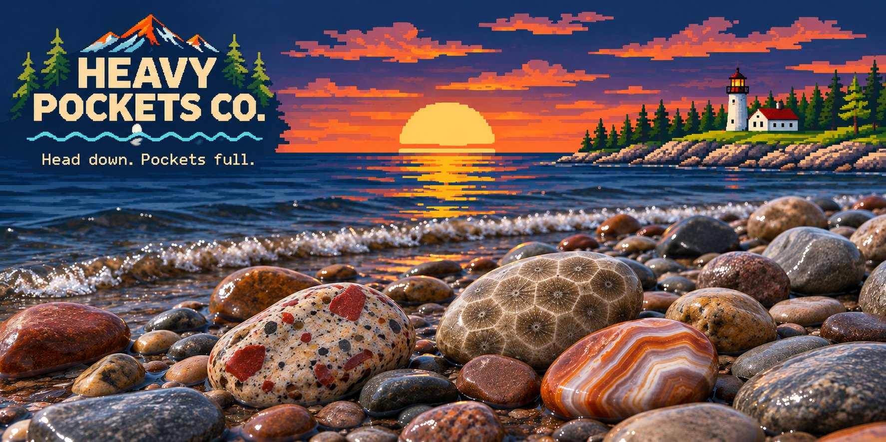

# Approved Hero — implementation handoff
Status: approved visual composition, **not deployed**.

This handoff concerns the owner's approved image from November 4, 2026, after correcting the puddingstone's jasper inclusion sizes.

## Produced assets
- `hero-approved-desktop.webp`: 1774×887, compressed full approved artwork, with baked-in logo and tagline.
- `hero-approved-mobile.webp`: 900×1200, deliberate two-panel mobile adaptation using only crops from the approved original. The seam between panels is an intentional framed divider, not a photographic blend; review on real devices.
- `hero-approved-desktop.jpg`: desktop compatibility backup.
The generated source master remains in the chat environment.

**Note:** The binary images are packaged as a downloadable archive in the ChatGPT conversation. They have not been uploaded to this GitHub repository because the GitHub text-file connection used for this handoff did not transfer image files. Copy these exact files into `brand/v2/hero-assets/` before using in a deployable page. Never silently substitute the older generated scene, and never claim the assets are already committed.

## Required markup
```html
<picture class="hero-art">
  <source media="(max-width: 680px)" type="image/webp" srcset="/brand/v2/hero-assets/hero-approved-mobile.webp">
  <source type="image/webp" srcset="/brand/v2/hero-assets/hero-approved-desktop.webp">
  
</picture>
```
The brand name and tagline are already **baked into the art**. Do not overlay duplicate logo or heading on top of them. For accessible semantics include a separate visually hidden page h1, and use live HTML for real navigation and CTAs.

## UI behavior
- Full-bleed image inside a dark navy framed hero, `display:block;width:100%;height:auto`. No `object-fit:cover` crop on desktop.
- On mobile load the art-directed variant at 680px and below. The mobile version is intentionally taller: keep a visible CTA immediately underneath.
- The image is decorative branding, not proof of merchandise quality. Continue clear product listings, verified prices, and a working checkout when implemented.
- Avoid overlay text, fake nav bars embedded in art, animations, filters, saturation boosts, or automatic recoloring.
- Keep a CSS/SVG fallback for development until binary assets are uploaded and verified.
- Check at 375px and 390px mobile, 768px tablet, and 1440px desktop. Measure load and CLS after integration; include explicit dimensions appropriate for the selected asset.
- Do not publish until owner accepts real-device crops and the actual files are included in a PR.

## Rights / source
The approved illustration was AI-generated in ChatGPT with geological references. Some reference photos are third-party. This approved scene is an original generated composite, not a direct reproduction request; check commercial suitability and accuracy before final launch. Owner photos are not assumed licensed until classified.

## Claude coordination
After asset transfer, implement on a separate branch and send screenshots/PR. Do not overwrite `step4-overnight-build` or merge to main automatically.
